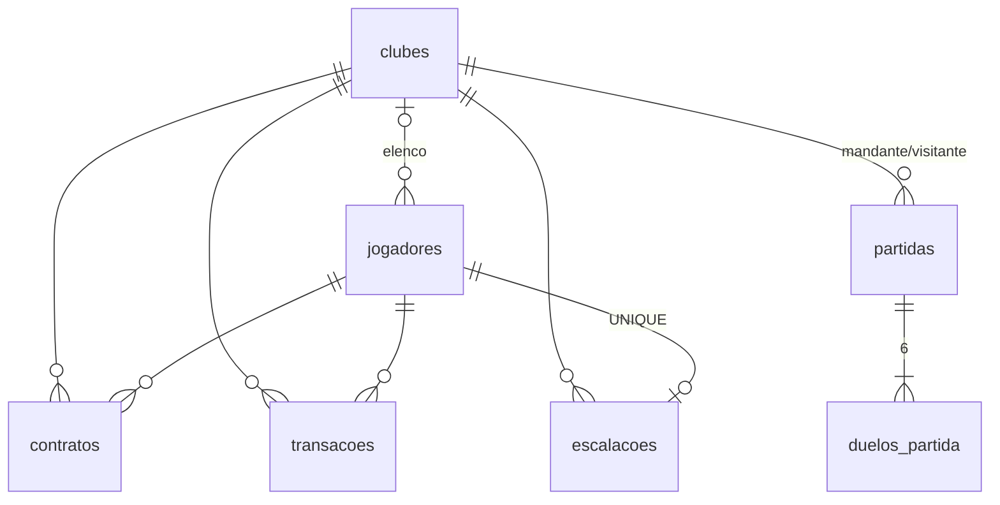

# Modelo de dados

Fonte: README oficial › "3. Estrutura de tabelas" e barema › B3. Esclarecimento da issue #3: só o **tipo das colunas de moeda** é conferido (DECIMAL/NUMERIC ou centavos); ENUM é aceito; CHECKs de limites não são exigidos; IDs inteiros com autoincremento.

## 1. Princípios

1. **Nomes exatos** das 7 tabelas e colunas obrigatórias (desvio custa ponto em B3 › Estrutura). Prisma em inglês com `@@map`/`@map` para os nomes em português — o barema exclui do critério de "nomes em mais de um idioma" os identificadores que só espelham o banco.
2. **Nenhuma coluna calculada**: valor de mercado, overall, valor do elenco, patrimônio, dias restantes, % de multa, pontos e posição **não existem no banco**.
3. **Snapshots históricos obrigatórios**: `contratos.valor_compra`, `transacoes.*` (nome, valores) e `duelos_partida.*` (nomes, posições, condições, valores) gravam o momento; nada é recalculado.
4. **Moeda em `NUMERIC`** com a precisão da tabela; no código, conversão para centavos inteiros na fronteira (ADR-002).
5. **Datas em `timestamptz(3)`** (instante absoluto; exibição sempre em `-03:00`).
6. Unicidades exigidas **no banco**: nome do clube (RN10), sigla, `escalacoes.jogador_id`.

## 2. Tabelas

Legenda: ✱ coluna adicional (permitida pelo enunciado).

### `jogadores` → `Player`

| Coluna | Tipo no banco | Prisma | Observação |
| --- | --- | --- | --- |
| id | serial PK | `id Int @id @default(autoincrement())` | |
| nome | varchar(100) | `name` | |
| posicao | enum `Position` (GOL, ZAG, LAT, MEI, ATA) | `position` | ENUM aceito (issue #3) |
| agilidade, idade | integer | `agility`, `age` | |
| valor_base | numeric(6,2) | `baseValue Decimal @db.Decimal(6,2)` | máx. teórico ≈ 364,32 |
| condicao | enum `Condition` | `condition @default(APTO)` | |
| clube_id | integer FK null | `clubId Int?` | nulo = livre |
| velocidade, finalizacao, passe, drible, defesa, fisico | integer | `pace`, `shooting`, `passing`, `dribbling`, `defending`, `physical` | |
| potencial | integer | `potential` | |
| excluido_em | timestamptz null | `deletedAt` | exclusão lógica |
| criado_em / atualizado_em | timestamptz | `createdAt @default(now())` / `updatedAt @updatedAt` | |

### `clubes` → `Club`

| Coluna | Tipo | Prisma | Observação |
| --- | --- | --- | --- |
| id | serial PK | `id` | |
| nome | varchar(60) | `name` | já normalizado pela V4 |
| ✱ nome_normalizado | varchar(60) **UNIQUE** | `normalizedName @unique` | `nome` em minúsculas, **acentos preservados** → garante RN10 no banco (ADR-006) |
| sigla | char(3) **UNIQUE** | `acronym @unique @db.Char(3)` | |
| caixa | numeric(10,2) default 300.00 | `cash Decimal @default(300)` | muda só em compra/venda |
| formacao | varchar(5) null | `formation String? @db.VarChar(5)` | `3-1`, `2-2`, `2-1-1`, `1-2-1` (validado na aplicação; não são identificadores válidos de enum) |
| criado_em | timestamptz | `createdAt` | |

### `contratos` → `Contract`

| Coluna | Tipo | Observação |
| --- | --- | --- |
| id | serial PK | |
| jogador_id / clube_id | FK | |
| valor_compra | numeric(6,2) | valor de mercado pago, **sem taxa** |
| fidelidade_ate | timestamptz | |
| situacao | enum `ContractStatus` (ATIVO, ENCERRADO, RESCINDIDO) | |
| iniciado_em / encerrado_em | timestamptz / timestamptz null | |

✱ Índice único parcial "um contrato ATIVO por jogador" seria desejável, mas o Prisma não expressa índices parciais no schema; a invariante é garantida pela transação da compra (jogador precisa estar livre). Reavaliar na etapa de compra.

### `transacoes` → `MarketTransaction`

O modelo se chama `MarketTransaction`, e não `Transaction`, para não confundir com a transação do banco (`prisma.$transaction`). O glossário oficial faz o mesmo alerta.

| Coluna | Tipo | Observação |
| --- | --- | --- |
| id | serial PK | |
| clube_id / jogador_id | FK | jogador excluído continua referenciado (exclusão lógica) |
| nome_jogador | varchar(100) | snapshot |
| tipo | enum `TransactionType` (COMPRA, VENDA) | |
| valor, taxa, multa | numeric(6,2) | |
| lucro | numeric(7,2) null | nulo na compra |
| variacao_caixa | numeric(8,2) | com sinal |
| criado_em | timestamptz | ordenação `criado_em desc, id desc` |

### `escalacoes` → `LineupSlot`

| Coluna | Tipo | Observação |
| --- | --- | --- |
| clube_id | FK | PK composta `(clube_id, jogador_id)` — **obrigatória** |
| jogador_id | FK **UNIQUE** | um jogador em no máximo uma escalação |
| criado_em | timestamptz | |

Escalação completa ⇔ 5 linhas para o clube. A formação fica em `clubes.formacao` e permanece quando um titular sai.

### `partidas` → `Match`

`id`, `mandante_id`, `visitante_id` (FK clubes), `gols_mandante`, `gols_visitante` (integer 0–3), `formacao_mandante`, `formacao_visitante` (varchar(5)), `jogada_em` (timestamptz). `result` é derivado dos gols na resposta (não é coluna obrigatória; derivar evita inconsistência).

### `duelos_partida` → `MatchDuel`

`id`, `partida_id` (FK), `ordem` (1–6), `clube_atacante_id` (FK), `atacante_id`, `defensor_id` (FK jogadores), `nome_atacante`, `nome_defensor` (varchar(100)), `posicao_atacante`, `posicao_defensor` (varchar(3)), `condicao_atacante`, `condicao_defensor` (varchar(20)), `atributo_ataque`, `atributo_defesa` (varchar(10): `shooting`/`passing`/`dribbling`/`defending`), `valor_ataque`, `valor_defesa` (integer), `gol` (boolean).

Colunas de snapshot em `duelos_partida` ficam como `varchar` (não enum) para registrar literalmente o momento, como na tabela oficial. ✱ Índice único adicional `(partida_id, ordem)`: cada partida tem um único duelo de cada ordem.

### Tipos ENUM no PostgreSQL

`posicao` (GOL, ZAG, LAT, MEI, ATA), `condicao_fisica` (APTO, MAL_CONDICIONADO, DOENTE), `situacao_contrato` (ATIVO, ENCERRADO, RESCINDIDO) e `tipo_transacao` (COMPRA, VENDA). Os nomes dos tipos ficam em português (`@@map`), como as tabelas.

## Implementação (Etapa 2, 17/10/2026)

- Schema: `backend/prisma/schema.prisma`. Migration inicial: `backend/prisma/migrations/20261017213311_init/`.
- Conferido no banco real: as 71 colunas obrigatórias existem com os nomes exatos; as 8 colunas de moeda são `numeric` com 2 casas; PKs (inclusive a composta de `escalacoes`), FKs e índices únicos conforme a seção 5.
- Simulação das inserções diretas do barema (B3), dentro de transação desfeita com `ROLLBACK`: os 4 casos se comportam como esperado.
- `migrate deploy` e `migrate reset --force` validados num banco temporário separado, removido depois.

## 3. Relacionamentos

FKs com `onDelete: Restrict` (não há exclusão física de nada).

## 4. Migrations e ciclo de vida

- Uma migration inicial com as 7 tabelas (modelo completo desde o início evita migrations corretivas). Migrations posteriores só aditivas; **migration aplicada nunca é editada**.
- Criar: `npx prisma migrate deploy`. Recriar do zero: `npx prisma migrate reset --force` (sem seed automático — o banco recriado começa vazio, como exige o README).
- Seed de exemplo, se existir, só por comando separado e marcado como opcional.
- Testes e2e usam banco separado (`DATABASE_URL` de teste) com limpeza (`TRUNCATE … RESTART IDENTITY CASCADE`) entre suítes.

## 5. Verificação da banca (B3 › Restrições)

| Inserção direta | Esperado | Garantido por |
| --- | --- | --- |
| "águias fc" com "Águias FC" existente | recusa | `nome_normalizado` UNIQUE (ambos → "águias fc") |
| "Aguias FC" com "Águias FC" existente | aceita | "aguias fc" ≠ "águias fc" |
| sigla repetida | recusa | `sigla` UNIQUE |
| mesmo jogador em 2 escalações | recusa | `escalacoes.jogador_id` UNIQUE |
